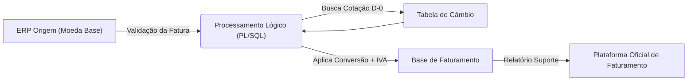

# ⚙️ Otimização de Faturamento Multimoeda e Cálculo de IVA (ERP para BI)

## 📌 O Desafio de Negócio
Em operações transnacionais, a consolidação financeira exige a unificação da moeda padrão no ERP. Contudo, o faturamento oficial ocorre muitas vezes em uma segunda plataforma e em moedas variadas (ex: Dólar). Quando o sistema de origem operava na moeda local e o cliente exigia faturamento em Dólar, a equipe perdia tempo realizando conversões cambiais manuais e recalculando valores unitários na Nota Fiscal para incluir o IVA. Isso gerava morosidade, atrito na operação e potenciais inconsistências de integração com o sistema oficial (Prodato).

## 🎯 O Objetivo
* Automatizar a conversão cambial do pedido de venda para a nota fiscal.
* Incorporar de forma automática e invisível o recálculo do IVA no valor unitário do produto.
* Gerar um relatório suporte espelhado na realidade da plataforma de emissão.
* Eliminar intervenções manuais na tela de faturamento.

## 📐 Arquitetura do Fluxo de Dados

## 🛠️ A Solução Técnica

Automatização via PL/SQL: Utilização de um bloco lógico vinculado ao comando da tela de faturamento para interceptar e modificar os valores em tempo de execução.

Resolução Dinâmica de Câmbio: Uso de queries SELECT INTO encadeadas para rastrear a moeda original do pedido e resgatar a cotação exata da data de emissão do documento (data_emissao).

Tratamento Customizado de Exceções: Implementação da função RAISE_APPLICATION_ERROR dentro do bloco EXCEPTION para travar operações sem lastro cambial no dia ou faturamentos sem vínculo de pedido.

Persistência Direta Transacional: Comandos de UPDATE isolados atualizam simultaneamente as linhas de itens com o novo valor (arredondado em 4 casas) e amarram o ID da cotação na capa da Nota.

## 🚀 Impacto Real

Eficiência Operacional: Erradicação do retrabalho na digitação linha a linha de produtos para correção do IVA, acelerando a liberação de faturas.

Redução de Risco Fisco-Financeiro: A taxa de conversão sistêmica impede divergências matemáticas entre o fechamento do ERP e o reporte oficial do país destino.

Governança de Dados para BI: Ao forçar o apontamento do cotacao_id na transação, assegura-se que a equipe de dados possa consumir faturamentos rastreáveis e unificados independentemente da moeda geradora.
